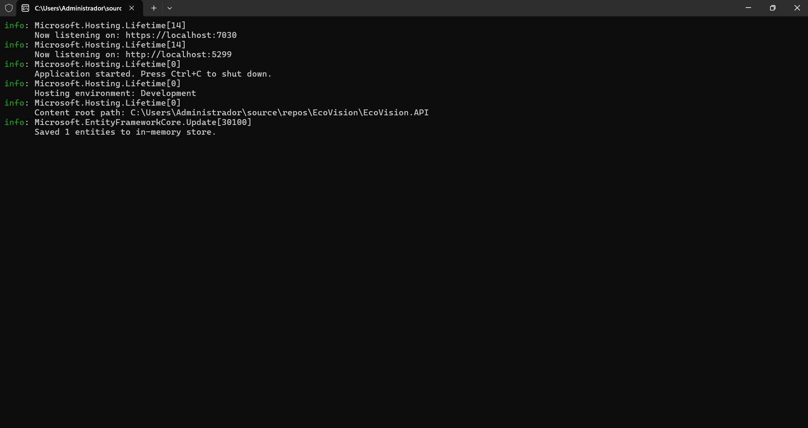
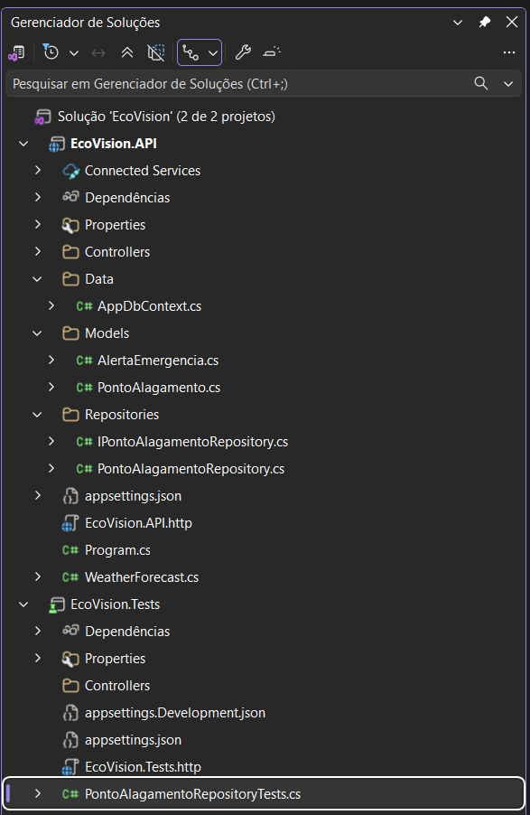
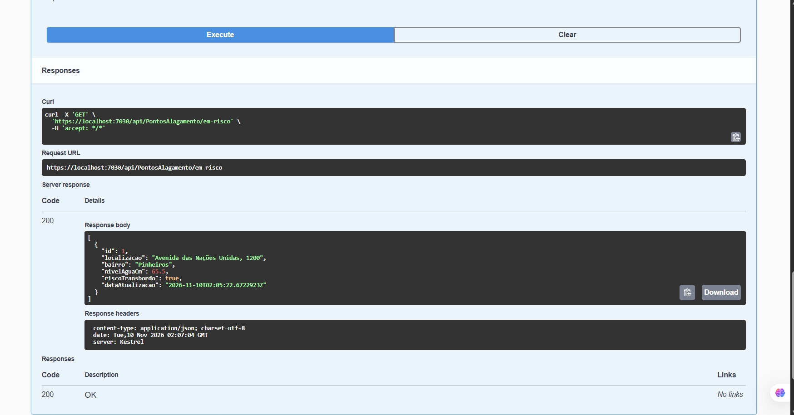
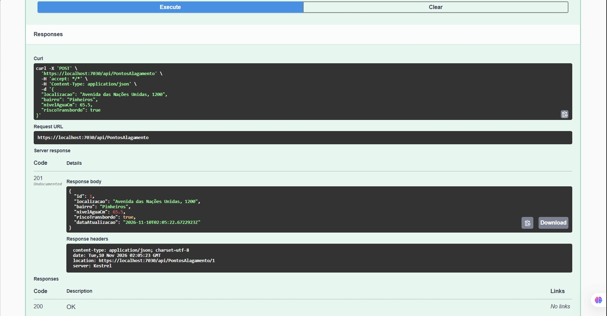
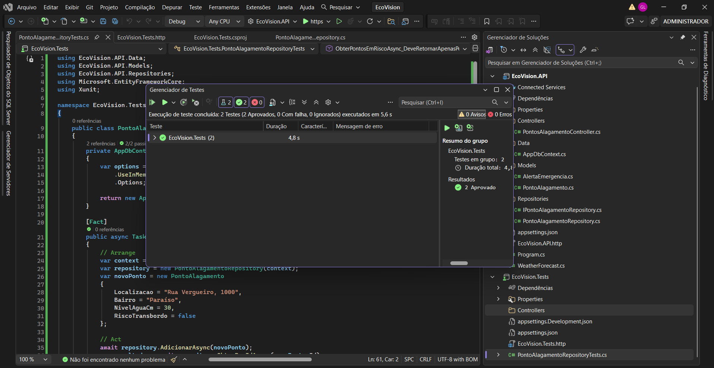

# 🌊 EcoVision - Monitoramento Urbano de Alagamentos

O **EcoVision** é uma plataforma de backend desenvolvida em **C# .NET 8** para a **Global Solution** da **FIAP** (CitizenTech), alinhada ao **ODS 11** (Cidades Sustentáveis) e **ODS 13** (Ação contra a Mudança Climática) da ONU.

---

## 👥 Integrantes do Grupo

- **Gabriel Guilherme** - RM558638 (Arquitetura Backend, APIs RESTful e Testes Unitários)
- **Gabriel Lacerda** - RM558307 (Modelagem de Dados, EF Core e Padrão Repository)
- **Fernando Carlos** - RM558095 (Documentação Técnica, Swagger UI e Prompts.md)
- **Julia Carolina** - RM558896 (Análise de Negócio e Alinhamento ODS/CitizenTech)

---

## 🚀 Tecnologias e Boas Práticas

- **C# / .NET 8 Web API**
- **Entity Framework Core (In-Memory)**
- **Repository Pattern** com injeção de dependência
- **Programação Assíncrona** (`async/await`)
- **Testes Unitários Automatizados** com xUnit
- **Documentação Interativa** com Swagger UI

---

## 🔌 Endpoints da API

- `GET /api/PontosAlagamento` - Lista todos os pontos de alagamento
- `GET /api/PontosAlagamento/{id}` - Busca um ponto por ID
- `GET /api/PontosAlagamento/em-risco` - Retorna locais com risco iminente
- `POST /api/PontosAlagamento` - Cadastra um novo ponto
- `PUT /api/PontosAlagamento/{id}` - Atualiza dados de um ponto
- `DELETE /api/PontosAlagamento/{id}` - Remove um ponto registrado

---

## 📸 Evidências de Funcionamento

Abaixo estão exibidas as capturas de tela que comprovam a compilação, arquitetura, testes e execução dos serviços:

### 1. Inicialização da Aplicação
Logs de startup do servidor Kestrel e confirmação do banco de dados em memória inicializado.

---

### 2. Arquitetura da Solução
Organização das camadas de software e estrutura de projetos no Visual Studio.

---

### 3. Validação dos Endpoints (Swagger UI)

**Consulta de Pontos em Risco (GET 200)**

**Cadastro de Ponto (POST 201)**

---

### 4. Testes Unitários Automatizados (xUnit)
Execução da suíte de testes no Test Explorer exibindo 100% dos testes aprovados (2/2).

## 📜 Registro de IA (Prompts)

Em conformidade com as diretrizes acadêmicas da FIAP, o ficheiro [`prompts.md`](./prompts.md) presente na raiz deste repositório documenta a utilização de assistentes virtuais baseados em Inteligência Artificial.

---

## 🙏 Agradecimentos e Considerações Finais

Agradecemos sinceramente a todo o corpo docente da **FIAP**, especialmente aos professores da disciplina de **C# Software Development**, pelos ensinamentos transmitidos ao longo do ano letivo.

---

*EcoVision © 2026 - Desenvolvido para a Global Solution FIAP.*
